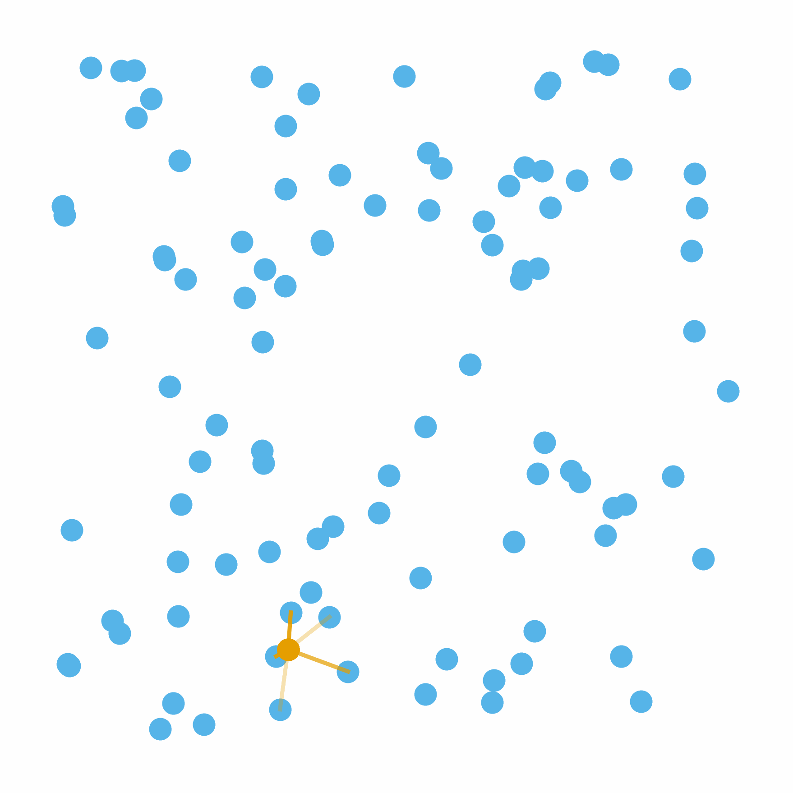
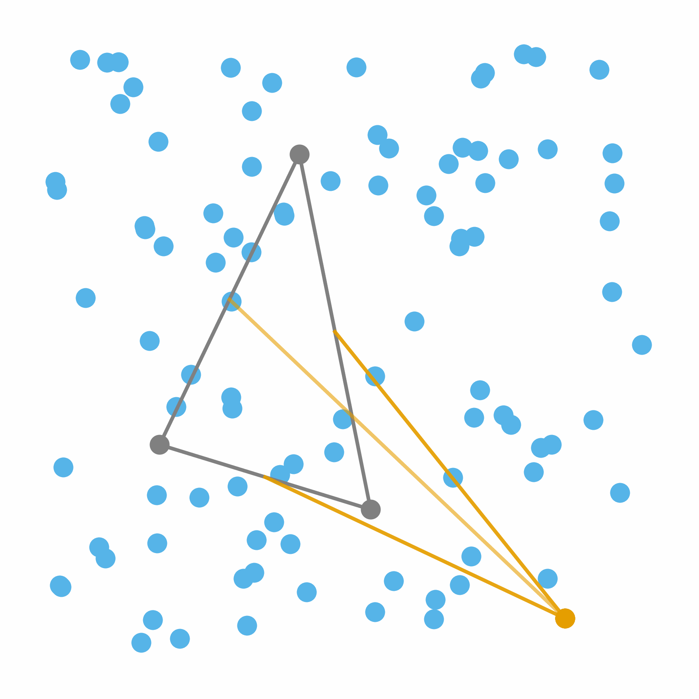
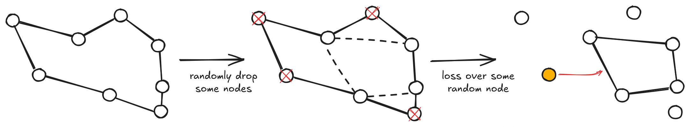
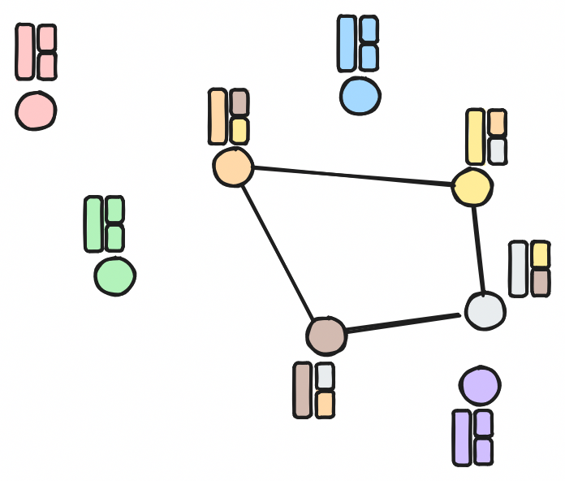
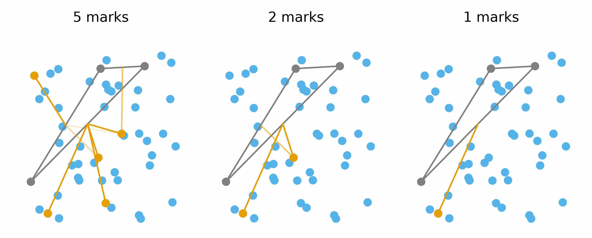
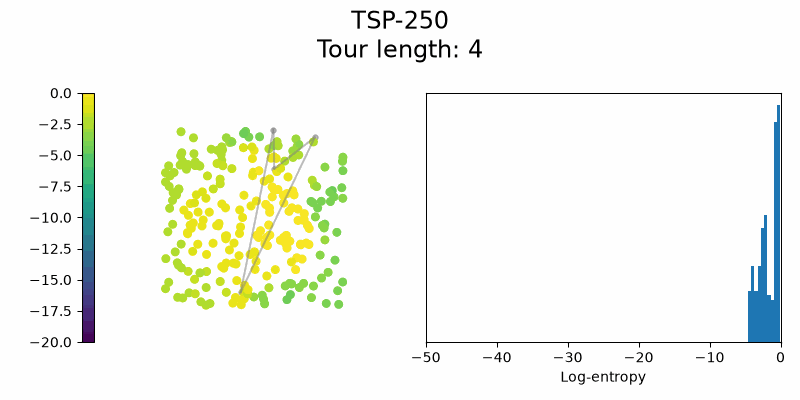
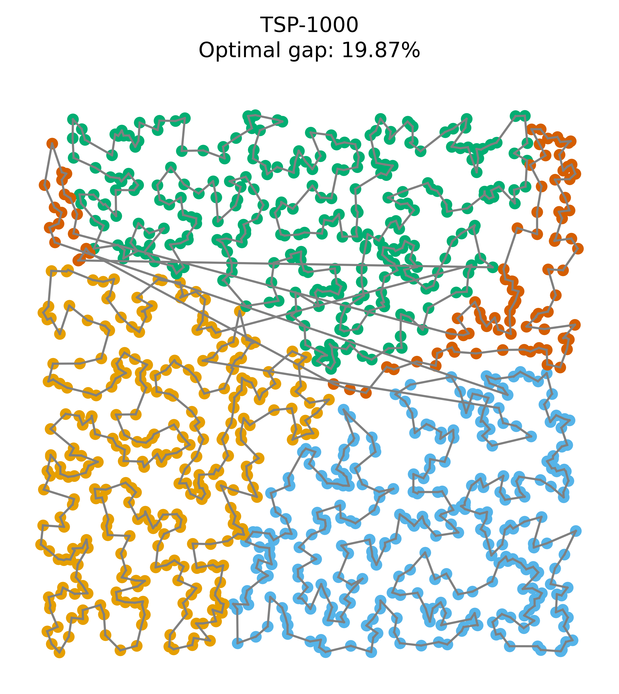

_This is a joint work with my supervisors Emanuele Natale and Frédéric Giroire._

The world of *autoregressive constructive neural TSP solvers* is dominated by next-visit
predictions: starting from an initial city, the model predicts the next cities one by one in the
sequence. This constructs the final tour, and we make sure at every step that only unvisited cities
can be selected to ensure a valid solution. In comparison, a neural insertion model maintains a tour
over all currently visited cities and inserts unvisited cities into its edges.

  <figure>
    
    <figcaption>Next-visit prediction</figcaption>
  </figure>

  <figure>
    
    <figcaption>Insertion prediction</figcaption>
  </figure>

Inserting cities is more flexible and makes it possible to predict multiple insertions in parallel.
Also, insertion heuristics [generally perform better][tsp-utils] than the greedy next-visit
heuristic, motivating my curiosity to compare their neural counterparts.

So far, only one neural insertion model has been proposed by [@Luo2025]. In their work, they select
the next city to insert as the unvisited city closest to the current tour. This limits inference
flexibility. **In this work we instead randomly select the cities to insert.**

Highlights:
- We propose a new neural insertion TSP solver. Compared to its predecessor, it randomly selects the
  cities to insert in the tour.
- We design a dedicated neural architecture that is simple and effective.
- We improve training efficiency by sampling difficult samples more often.
- We exploit its flexibility to expose a time-quality trade-off. We can insert multiple cities at
  once to cut the total inference time, at the cost of solution quality.
- We show how using 2-OPT unlocks a divide-and-conquer solver that makes our solver scalable.
- We achieve state-of-the-art performance among constructive neural solvers and remain competitive
  with other types of solvers.

## The Traveling Salesman Problem

The Euclidean TSP is an NP-hard problem defined by a set of $N$ cities $\{x_i\}_{i = 1}^N$ in the 2D
Euclidean plane. The goal is to find the shortest cycle that visits all cities exactly once. City
coordinates are represented by a matrix $X \in \mathbb{R}^{N \times 2}$. Random instances are
generated by sampling cities uniformly in the unit square. Solutions are evaluated using the
optimality gap:

$$
  \text{gap}(\%) = 100 * \frac{\text{cost}_{\text{pred}} - \text{cost}_{\text{opt}}}{\text{cost}_{\text{opt}}},
$$

where $\text{cost}_{\text{pred}}$ is the length of the predicted solution and
$\text{cost}_{\text{opt}}$ is the length of the optimal solution.

## Training algorithm

Training uses supervised learning on a set of 1M random TSP instances solved to optimality with
`Concorde` ([@Applegate2006]). Starting from the optimal tour, we remove some random nodes while
keeping track of the edge into which each should be reinserted. We ask the model to retrieve that
edge for any random node we select. The node to insert is marked (see the model architecture), and
the loss is computed only for this specific node. The loss is the cross-entropy over the set of
edges in the tour.

## Model architecture

The neural architecture needs four things:
1. Represent the current tour.
2. Know which city is to be inserted.
3. Let information flow between cities easily (even between those that are not connected).
4. Output a probability for each edge of the tour.

Another constraint is that I don't want to use GNNs. I prefer the ease of use of Transformers and
their reliability. Using a GNN would open too many options.

We note the current tour of length $T$ as the sequence of cities $(t_1, t_2, \dots, t_T)$. Since it
is a cycle, we define $t_{-1} = t_T$ and $t_{T + 1} = t_1$.

**Tour representation.** I started with custom attention operations that, for example, allowed only
currently unvisited cities to attend to visited ones. But that led to complex attention schemes,
which were generally sparse and less efficient (with attention biases here and there). Instead, I
propose to encode the tour simply by concatenating neighboring cities' embeddings:

$$
  \hat{x}_{t_i} = x_{t_i} \parallel (x_{t_{i - 1}} + x_{t_{i + 1}}),
$$

where $x_i \in \mathbb{R}^h$ is the embedding of city $i$. The new representation $\hat{x}_{t_i} \in
\mathbb{R}^{2 h}$ is then projected back to $\mathbb{R}^h$ with an MLP. We consider unvisited nodes
to be their own neighbors. Note that summing the neighbors' embeddings loses the tour's orientation,
making the model invariant to it. We then use classical self-attention so that all nodes (visited
and unvisited) can freely exchange information without wasting FLOPs.

**Marking the city to insert.** To specify which city is to be inserted, I use a dedicated learned
embedding added to the city or cities to insert. This teaches the model to focus its predictions on
the marked cities.

Visited and unvisited cities are marked with additional dedicated learnable markers.

**Probability of insertion.** Finally, we take the output of the last transformer layer and
represent each edge by the sum of its endpoint cities' embeddings:

$$
  e_{u v} = x_u + x_v \in \mathbb{R}^h,
$$

where $u$ and $v$ are two consecutive cities in the current tour. The logit for inserting an
unvisited city $m$ between cities $u$ and $v$ is computed using the dot product:

$$
  l_{m, u v} = \frac{x_m e_{u v}^T}{\sqrt{h}}.
$$

**Comparison with L2C ([@Luo2025]).** L2C uses a classical encoder-decoder Transformer. The encoder
processes the cities' Euclidean coordinates, and the decoder generates insertion probabilities given
a tour and a city to be inserted. Their model is very similar to ours and differs only slightly in
the following ways:
- Tokens in their decoder are both edges (by combining nodes embeddings) and unvisited nodes.
- Each decoding iteration uses the same shared representation from the encoder.

In comparison, our tokens always represent nodes, and edges are constructed only at the very end of
the model to generate the output probabilities. Also, each decoding iteration starts from a blank
representation, and the Euclidean information is processed on the fly depending on the current state
of the tour.

## Parallel insertions

Since any unvisited node can be inserted at any time, we can ask the model to predict insertion
edges for multiple unvisited nodes at the same time. As long as the predicted edges are distinct, we
can safely insert those nodes in one go.

Such model is trained with multiple randomly selected unvisited cities marked during training. The
loss is computed only for the marked cities.

## Difficulty-based step sampling

Early steps are the hardest for the model: many cities remain unvisited, and the model must decide
which edge to use for inserting a city. Therefore, we replace uniform sampling of the construction
step with sampling biased toward earlier steps. This trains the model more often on harder cases and
wastes less computation on simpler ones.

We sample the construction step from a $\text{Beta}(1, 4)$ distribution, which is skewed toward the
beginning of the construction process.

## Greedy results

We trained 4 models, covering the following:
- Uniform step sampling (U) vs difficulty-based step sampling (D).
- Single insertion training (S) vs multiple insertions training (M).

Models are trained on 1 million TSP-256 instances for approximately 6 hours on a single RTX-5090.
Multi-insertion models are trained with up to 10 insertions at the same time. We compute the cost
gap relative to the optimal solution (in $\%$). Generation is greedy: we mark one city at a time and
always select the most probable insertion.

| Variant | TSP-100 | TSP-250 | TSP-500 | TSP-1,000 | TSP-10,000 |
|:--------|:-------:|:-------:|:-------:|:---------:|:----------:|
| U-S     | 1.53    | 1.16    | 1.24    | 1.56      | 3.70       |
| D-S     | 1.00    | 0.72    | 0.84    | 1.15      | 4.67       |
| U-M     | 0.85    | 0.75    | 0.88    | 1.33      | 6.44       |
| D-M     | 0.58    | 0.42    | 0.63    | 1.00      | 34.46      |

Both difficulty-based step sampling and multi-insertion training improve training efficiency. The
model wastes less training time on easy samples and is trained on many targets at the same time.
However, for large-scale generalization, the model that learns most slowly (U-S) achieves the best
results.

The remaining results use the `D-M` model. We exploit its multi-insertion capability and rely on a
divide-and-conquer approach to tackle large TSP-10,000 instances.

## Multi-insertion analysis

Multi-insertion models can solve an instance faster by sampling multiple unvisited cities to insert
concurrently. This allows them to trade solution quality for computation time:

| Parallel | TSP-250 |        | TSP-1000 |        |
|:---------|:-------:|:------:|:--------:|:------:|
|          | _Gap_   | _Time_ | _Gap_    | _Time_ |
| 1 mark   | 0.46    | 0.5m   | 1.00     | 1.5m   |
| 2 marks  | 0.61    | 0.4m   | 1.81     | 0.8m   |
| 5 marks  | 1.17    | 0.4m   | 3.09     | 0.4m   |
| 10 marks | 1.37    | 0.1m   | 3.90     | 0.3m   |

We can verify that the model struggles when multiple cities are marked at the same time by comparing
solutions obtained by marking cities in parallel with those obtained by marking them sequentially
but inserting them all at once.

| Variant               | TSP-250 | TSP-1000 |
|:----------------------|:-------:|:--------:|
| 10 marks (parallel)   | 1.37    | 3.90     |
| 10 marks (sequential) | 1.02    | 1.36     |

The difference is more pronounced on harder instances, which makes sense because the model needs
more brain juice there.

## Sparse solver

Most neural TSP solvers admit a sparse version that allows large-scale instances to be solved in a
manageable amount of time. It is not obvious how to apply the usual approach of giving a reduced set
of cities to our model. We propose a simple divide-and-conquer approach in which sub-instances are
sampled from the original large instance, solved independently, and then combined. Partial solutions
are appended and we use 2-OPT to repair the resulting global solution.

  <figure>
    
    <figcaption>Initial solution from TSP-300 sub-instances.</figcaption>
  </figure>

  <figure>
    
    <figcaption>2-OPT repair.</figcaption>
  </figure>

Using sub-instances avoids giving all 10,000 cities to the model. The sparse solution followed by
2-OPT repair takes 0.3 minutes with sub-instances of size 500.

**Sparse Random-Reconstruct (RRC).** We can improve the solution further with RRC, at the cost of a
longer total runtime. RRC iteratively destroys the best solution and resolves the resulting
sub-instance for a fixed number of iterations. In our implementation, we select a random city and
its kNN neighbors. We remove those cities from the solution to form a new sub-instance. Our model
generates a solution for this sub-instance, which we then recombine with the original solution using
2-OPT. We keep the resulting solution if it is better than the previous one.

|                                | TSP-10,000 |        |
|:-------------------------------|:----------:|:------:|
|                                | _Gap_      | _Time_ |
| Original full solution         | 34.46      | 19m    |
| Sparse solution                | 25.83      | 0.3m   |
| Sparse solution + repair       | 4.33       | 0.3m   |
| Sparse solution + repair + RRC | 1.82       | 27m    |

## Putting it all together

We can finally compare our model with other state-of-the-art neural TSP solvers. Every solver is
evaluated with a batch size of 1 on my RTX-5090 and on the same set of instances. We report the
total solving time. There are 128 random instances for each size from TSP-100 to TSP-1000, solved to
optimality using Concorde. There are also 10 random TSP-10,000 instances, solved to near-optimality
with LKH.

For instances with fewer than 1,000 cities, we take the best solution out of 128 generated ones. For
the TSP-10,000 instances, we use the sparse-RRC decoding algorithm with 1,000 RRC iterations and
sub-instances of size 500. All solutions are generated with 10 insertions in parallel. We obtain
different solutions for the same instance by shuffling the insertion order.

We call our solver _Random Neural Insertions_ (RNI).

| Model               | TSP-100  |        | TSP-250  |        | TSP-500  |        | TSP-1000  |        | TSP-10,000 |        |
|:--------------------|:--------:|:------:|:-------: |:------:|:--------:|:------:|:---------:|:------:|:----------:|:------:|
|                     | _Gap_    | _Time_ | _Gap_    | _Time_ | _Gap_    | _Time_ | _Gap_     | _Time_ | _Gap_      | _Time_ |
| BQ-NCO              | 0.08     | 0.5m   | 0.17     | 2.3m   | 0.58     | 6.8m   | 1.43      | 16m    | 20.94      | 51m    |
| PENS-AR             | 0.01     | 2.8m   | 0.10     | 3.8m   | 0.33     | 7.5m   | 0.72      | 26m    | 3.29       | 24m    |
| DGL                 | 0.27     | 0.5m   | 0.71     | 1.2m   | 1.20     | 2.4m   | 1.76      | 4.2m   | 2.90       | 6.0m   |
| L2C                 | 0.08     | 2.0m   | 0.44     | 5.5m   | 1.34     | 7.5m   | 3.38      | 9.4m   | 1.91       | 48m    |
| SIL                 | 1.71     | 2.0m   | 1.18     | 5.1m   | 1.01     | 10.6m  | 1.26      | 22m    | 2.01       | 21m    |
| RNI _(ours)_        | 0.02     | 0.4m   | 0.03     | 0.6m   | 0.12     | 2.2m   | 0.49      | 12.6m  | 1.82       | 27m    |

BQ-NCO ([@Drakulic2023]), DGL ([@Xiao2025]), SIL ([@Luo2024]), PENS-AR ([@Pereira2026]) and L2C
([@Luo2025]) are other constructive neural solvers, with L2C being the only other insertion model.
They are evaluated with their own best decoding algorithms.

| Model               | TSP-100  |        | TSP-250  |        | TSP-500  |        | TSP-1000  |        | TSP-10,000 |        |
|:--------------------|:--------:|:------:|:-------: |:------:|:--------:|:------:|:---------:|:------:|:----------:|:------:|
|                     | _Gap_    | _Time_ | _Gap_    | _Time_ | _Gap_    | _Time_ | _Gap_     | _Time_ | _Gap_      | _Time_ |
| Fast T2T            | 1.04     | 1.0m   | 0.60     | 1.4m   | 0.69     | 3.4m   | 0.80      | 8.8m   | 1.48       | 4.9m   |
| COExpander          | 0.02     | 0.3m   | 0.15     | 1.2m   | 0.29     | 2.4m   | 0.62      | 5m     | 1.29       | 14m    |
| UDC                 | 0.35     | 3.3m   | 2.16     | 2.0m   | 1.56     | 3.6m   | 1.77      | 21m    | 8.73       | 3.7m   |
| MaskCO              | 0.01     | 0.2m   | 0.01     | 0.3m   | 0.01     | 0.3m   | 0.01      | 0.5m   | 674        | 7m     |
| RNI _(ours)_        | 0.02     | 0.4m   | 0.03     | 0.6m   | 0.12     | 2.2m   | 0.49      | 12.6m  | 1.82       | 27m    |

COExpander ([@Ma2025]), FastT2T ([@Li2024]), and MaskCO ([@Chen2026]) are discrete diffusion
solvers. UDC ([@Zheng2024]) is a divide-and-conquer solver similar to our sparse approach.

Note that BQ-NCO, PENS-AR, DGL, and L2C are trained on TSP-100 instances, while the other approaches
are trained at the same scale at which they are evaluated. Our solver is trained on TSP-256
instances (training on TSP-100 showed overfitting behaviour).

Overall, performance is highly competitive. RNI comes out first among the other constructive solvers
and is quite comparable to non-constructive approaches.

---

## Extra

**Tour encoding variants.** We initially played with multiple attention ideas:
- Dedicated MHA layer with attention bias relative to the tour distance (only the visited nodes
would participate).
- Dedicated MHA layer with attention bias relative to the insertion cost (only unvisited nodes would
attend to visited nodes).
- Mixing both attentions at the same time.

Overall, these approaches added a lot of complexity for little gain, so we dropped them and used our
simpler tour encoding. The most promising results were obtained with three dedicated MHAs: one for
unvisited nodes over insertion edges, one for visited nodes over themselves, and one global MHA
without any bias. But the three attention operations required per layer made this approach too
expensive.

**Architecture details.** Coordinates are encoded using 2D RoPE, similar to PENS-R. The markers
(insertion, visited, and unvisited) are added at the beginning of every layer during tour encoding.

**Marker schedules.**
We can vary the number of insertions $m(t)$ during solution generation:

$$
\begin{aligned}
  m_\text{fixed}(t) &= m_\text{max} \\
  m_\text{linear}(t) &= \lfloor t \times m_\text{max} + (1 - t) \times 1 \rceil \\
  m_\text{reversed linear} &= \lfloor t \times 1 + (1 - t) \times m_\text{max} \rceil,
\end{aligned}
$$

where $t = \frac{N_\text{visited}}{N} \in [0, 1]$ is the current progress of the solution
generation. Up until now, we've been using the fixed schedule.

| Schedule                 | TSP-250 |        | TSP-1000 |        |
|:-------------------------|:-------:|:------:|:--------:|:------:|
|                          | _Gap_   | _Time_ | _Gap_    | _Time_ |
| 1 mark                   | 0.46    | 0.5m   | 1.00     | 1.5m   |
| 3 marks fixed            | 0.77    | 0.2m   | 1.73     | 0.6m   |
| 5 marks fixed            | 1.17    | 0.4m   | 3.09     | 0.4m   |
| 10 marks fixed           | 1.37    | 0.1m   | 3.90     | 0.3m   |
| 10 marks linear          | 0.67    | 0.2m   | 2.82     | 0.5m   |
| 10 marks reversed linear | 1.02    | 0.2m   | 1.89     | 0.5m   |

It is unclear why the reversed linear schedule works so well on TSP-1000. We expect the linear
schedule to consistently outperform the fixed schedule, with only a small increase in computation.

**Entropy-based insertion order.** Instead of randomly selecting the unvisited cities to insert, we
use the model's insertion confidence scores to decide which city to insert next.

At each step, we sample 10 unvisited cities, and the model predicts an insertion distribution over
the current tour edges for each city. For a city $m$, we compute the normalized entropy of its
predicted distribution $p_m$:

$$
  H(m) = -\frac{1}{\log T}\sum_{e=1}^T p_m(e)\log p_m(e),
$$

where $T$ is the number of edges in the current tour.

|                                  | TSP-100  |        | TSP-250  |        | TSP-500  |        | TSP-1000  |        |
|:---------------------------------|:--------:|:------:|:-------: |:------:|:--------:|:------:|:---------:|:------:|
|                                  | _Gap_    | _Time_ | _Gap_    | _Time_ | _Gap_    | _Time_ | _Gap_     | _Time_ |
| baseline                         | 0.66     | 0.4m   | 0.46     | 0.3m   | 0.62     | 0.6m   | 1.09      | 1.5m   |
| 10 marks (entropy)               | 0.66     | 0.4m   | 0.32     | 0.5m   | 0.44     | 1.1m   | 0.70      | 4.1m   |
| 10 marks (parallel) + best-of-10 | 0.21     | 0.4m   | 0.16     | 0.3m   | 0.37     | 0.8m   | 0.79      | 3.8m   |

Compared to the single-insertion baseline, using an entropy-based insertion priority leads to better
solutions. Compared with 10 parallel marks and best-of-10, it performs worse on TSP-100 to TSP-500,
but is slightly better on TSP-1000. A promising next step would be to predict insertion order
directly rather than using this entropy heuristic.

[tsp-utils]: https://tangled.org/pierrot-lc.bsky.social/tsp-utils
