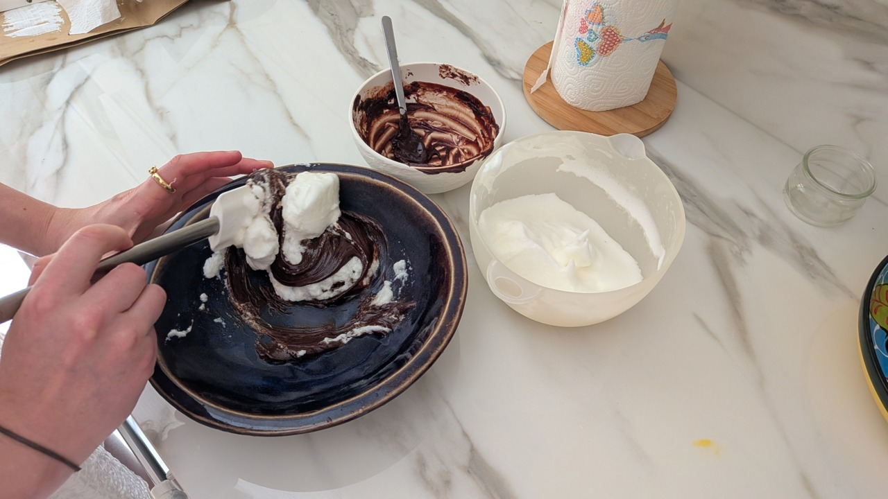

Une recette connue et maîtrisée par Laëtitia!!!

## Ingrédients

- 200g de chocolat noir
- 4 oeufs (bio?)
- 1 sucre vanillé
- 50g de sucre (facultatif)
- 1 pincée de sel

## Instructions

1. Faire fondre le chocolat en le cassant dans un bain-marie, couvrir et attendre ~10 minutes.
2. Vider l'eau, ajouter les jaunes oeufs et le sucre.
3. Monter les blancs en neige, ajouter le seul puis mélanger en soulevant le chocolat à l'aide d'une
   *marise*. Idéalement, les blancs sont froids.
4. Mettre au frais pendant 3h!

